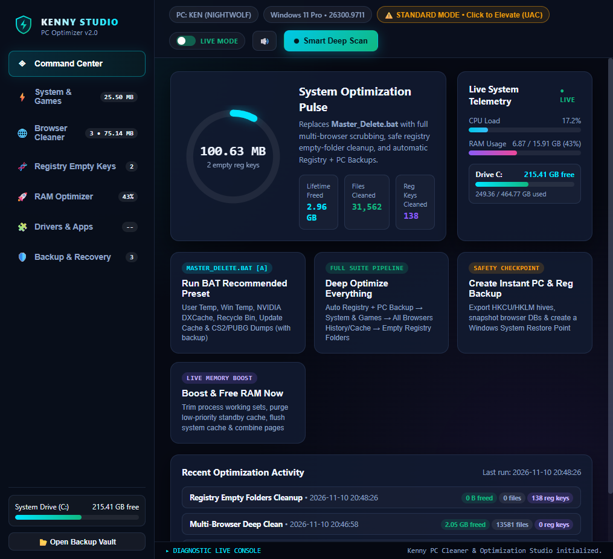
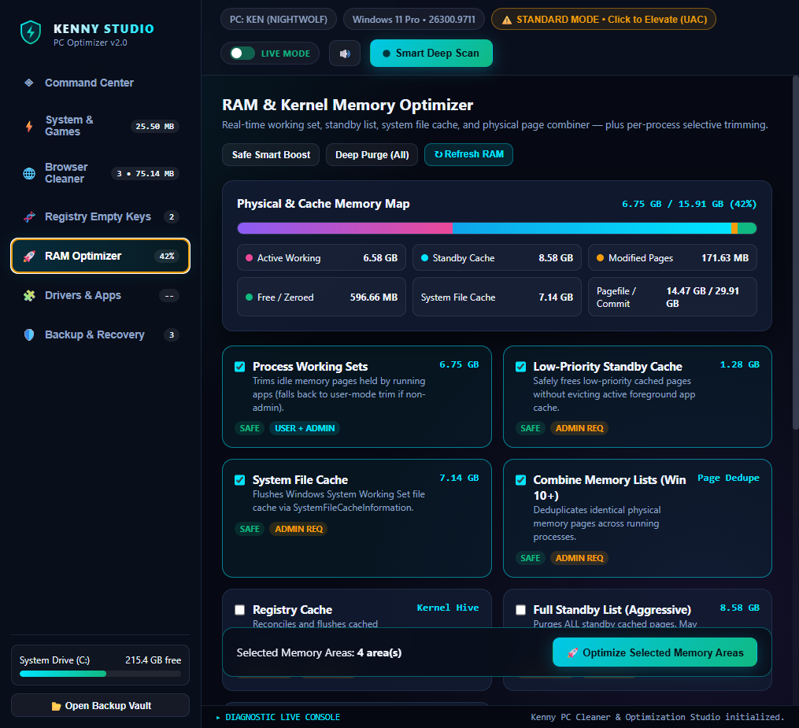
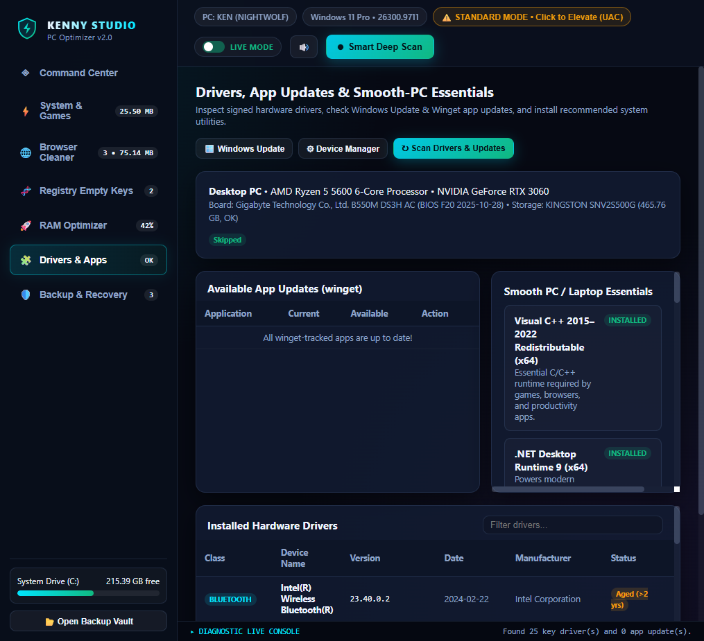
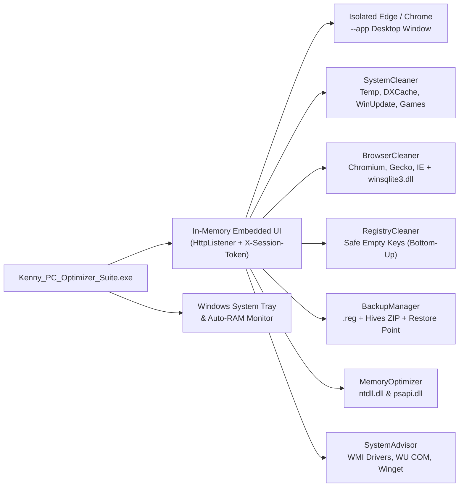
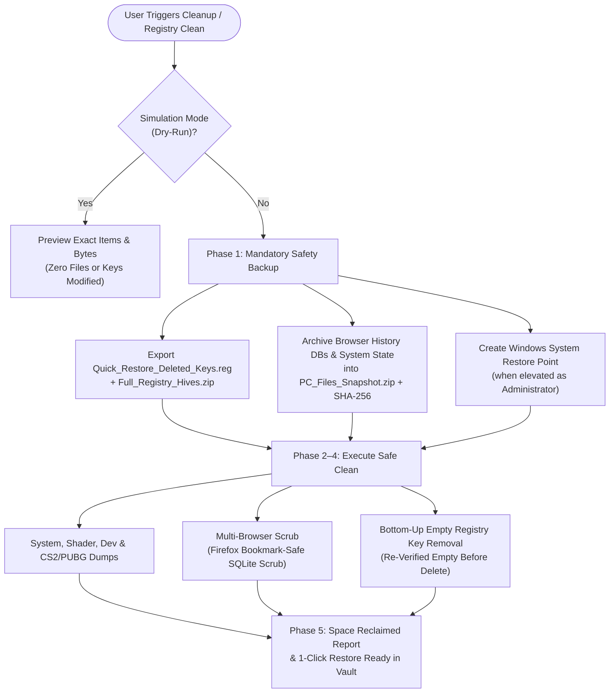

<div align="center">



<br/>

[](https://github.com/akashmark8-cloud/kenny-pc-optimizer-studio/releases/latest)
[](https://github.com/akashmark8-cloud/kenny-pc-optimizer-studio/actions/workflows/ci-and-release.yml)
[](LICENSE)
[](https://github.com/akashmark8-cloud/kenny-pc-optimizer-studio/releases/latest)
[](src/build.ps1)

**[⬇ Download Standalone EXE (v2.0.0)](https://github.com/akashmark8-cloud/kenny-pc-optimizer-studio/releases/latest)** · **[Features](#-core-modules)** · **[Architecture](#-standalone-architecture)** · **[Safety Pipeline](#-pre-clean-backup--recovery-flow)** · **[Build](#-build-from-source)**

</div>

---

## ✨ Overview

**Kenny PC Optimizer Studio** is a **100% standalone, single-file Windows x64 application** compiled natively in C# (.NET Framework 4.x). All cleaning engines, SQLite history scrubbing (`winsqlite3.dll`), registry & backup orchestration, NT kernel RAM optimization, driver/winget advisors, and the interactive cyber-obsidian UI are embedded directly inside a single `.exe` — **no Python, no installer, and no external files required**.

---

## 📸 Interface Preview

<div align="center">

### Command Center & Telemetry Pulse


<br/><br/>

### RAM & Kernel Memory Optimizer


<br/><br/>

### Drivers, Winget App Updates & Smooth-PC Essentials


</div>

---

## 🏗 Standalone Architecture

Every HTML/CSS/JS UI resource and icon is compiled directly into the `.exe` assembly and served from memory over an ephemeral token-protected `HttpListener`, while native Win32/NT/WMI/COM calls execute directly in-process:



---

## 🛡 Pre-Clean Backup & Recovery Flow

Cleaning empty registry folders or browser history automatically enforces a **Pre-Clean Safety Gate** before touching anything, storing timestamped, SHA-256 verified snapshots inside `%USERPROFILE%\Documents\Kenny_PC_Optimizer_Backups`:



---

## ⚡ Core Modules

| Module | What It Does | Key Safety Highlights |
| :--- | :--- | :--- |
| **System & Game Cleaner** | Replaces & upgrades `Master_Delete.bat`: User Temp, Windows Temp, NVIDIA `DXCache` (+ `D3DSCache`/`GLCache`/`AMD DxCache`), Recycle Bin (all drives), Windows Update `SoftwareDistribution\Download`, `npm`/`pip` caches, CS2 `.mdmp` across all Steam libraries & PUBG crashes/logs. | Safely stops & restarts `wuauserv` in `try/finally`; protects backup vault & runtime paths; marks locked OS paths `Admin Req`. |
| **Universal Browser Cleaner** | Auto-detects Chromium (`Chrome`, `Edge`, `Brave`, `Opera`, `Opera GX`, `Vivaldi`, `Arc`, `Thorium`, `Yandex`, `Comet`, `DuckDuckGo`), Gecko (`Firefox`, `LibreWolf`, `Waterfox`, `Zen`, `Floorp`, `Pale Moon`), and IE/WebCache — including leftover folders of uninstalled browsers. | **Bookmark-safe Firefox scrubbing** via Windows `winsqlite3.dll` clears `moz_historyvisits` while keeping bookmarks; running-process closer excludes the app's own window; Cookies are opt-in (off by default). |
| **Registry Empty Folders** | Scans `HKCU\Software`, `HKLM\SOFTWARE` (64-bit), and `WOW6432Node` (32-bit) for empty keys (`0` named/default values and empty subtrees). | Strictly skips protected OS/vendor trees (`Microsoft`, `Classes`, `Policies`, `AppDataLow`, `DirectX`, etc.), deletes deepest-first, and enforces `.reg` + hive backup beforehand. |
| **Backup & Recovery Vault** | Manages timestamped snapshots with `Quick_Restore_Deleted_Keys.reg`, `Full_Registry_Hives.zip`, `PC_Files_Snapshot.zip`, `EMERGENCY_RESTORE.bat`, and Windows Restore Points (`rstrui.exe`). | SHA-256 checksum verification (`manifest.json`), 1-click in-app file & registry restore, and standalone offline recovery script. |
| **RAM & Kernel Optimizer** | Live Physical/Standby/Modified/System-Cache breakdown (`NtQuerySystemInformation` + `GetPerformanceInfo`), 7 NT memory regions (Working Sets, Low-Priority Standby, System File Cache, Combine Pages, Registry Cache, Full Standby, Modified List), per-process trimming, and Auto-Boost rules. | Safe defaults prevent UI stutter; user-mode `EmptyWorkingSet` fallback works without Admin; Tray **Boost RAM Now** shortcut + balloon summary. |
| **Drivers, Apps & Essentials** | Audits signed PnP hardware drivers, BIOS & disk health, pending Windows Update drivers/security patches, `winget upgrade` app updates, and recommended smoothness utilities (`PowerToys`, `Everything`, `CrystalDiskInfo`, `HWiNFO`, `.NET`, `VC++`). | 1-click package updates/installs via `winget` with strict package ID validation and live log streaming. |

---

## 🚀 Quick Start

1. Download **`Kenny_PC_Optimizer_Suite.exe`** from the **[Latest Release](https://github.com/akashmark8-cloud/kenny-pc-optimizer-studio/releases/latest)**.
2. Double-click `Kenny_PC_Optimizer_Suite.exe` from anywhere (Desktop, Downloads, or USB).
3. For full system privileges (`Windows Temp`, `wuauserv`, `HKLM\SOFTWARE`, kernel Standby/Cache lists, and System Restore Points), right-click → **Run as administrator** or click **Elevate (UAC)** inside the app header.

## 🔒 Build Verification & Transparency

- Every release binary is compiled directly on GitHub's `windows-latest` runner via [ci-and-release.yml](.github/workflows/ci-and-release.yml) with **SLSA build provenance attestation**.
- Each release attaches `SHA256SUMS.txt` and a direct **VirusTotal** SHA-256 verification link inside the Release Notes.
- Zero external runtime downloads, zero background telemetry, and an interactive **Simulation (Dry-Run)** mode to preview every operation safely.

---

## 🛠 Build from Source

Requires **Windows 10 / 11** with built-in `.NET Framework 4.x` (`csc.exe` — no Visual Studio or SDK downloads required):

```powershell
# Compile single-file standalone executable
powershell -NoProfile -ExecutionPolicy Bypass -File .\src\build.ps1 -OutName Kenny_PC_Optimizer_Suite.exe
```

### Run Automated Tests

```powershell
$csc = "C:\Windows\Microsoft.NET\Framework64\v4.0.30319\csc.exe"
$testExe = "$env:TEMP\kenny_tests.exe"
& $csc /nologo /platform:x64 /out:$testExe `
  /resource:"src\ui\index.html,ui.index.html" `
  /resource:"src\ui\styles.css,ui.styles.css" `
  /resource:"src\ui\app.js,ui.app.js" `
  /resource:"src\assets\app_icon.ico,assets.app_icon.ico" `
  /r:System.dll /r:System.Drawing.dll /r:System.Windows.Forms.dll `
  /r:System.IO.Compression.dll /r:System.IO.Compression.FileSystem.dll `
  /r:System.ServiceProcess.dll /r:System.Management.dll /r:System.Web.Extensions.dll `
  src\Config.cs src\SystemInfo.cs src\SqliteHelper.cs src\JobManager.cs `
  src\BackupManager.cs src\SystemCleaner.cs src\BrowserCleaner.cs `
  src\RegistryCleaner.cs src\MemoryOptimizer.cs src\SystemAdvisor.cs `
  src\WebServer.cs tests\StandaloneTests.cs
& $testExe
```

---

## 📂 Repository Structure

```text
├── docs/images/          # Animated hero banner & live UI screenshots
├── src/
│   ├── Config.cs         # Protected paths, registry exclusions & app dirs
│   ├── SystemInfo.cs     # CPU, RAM, disk, Steam VDF & persistent settings/stats
│   ├── SqliteHelper.cs   # Native winsqlite3.dll P/Invoke for bookmark-safe Firefox scrub
│   ├── BackupManager.cs  # Surgical .reg, full hive ZIP, PC snapshot & Restore Points
│   ├── SystemCleaner.cs  # Temp, Shader, Recycle Bin, wuauserv, dev & game dump cleaner
│   ├── BrowserCleaner.cs # Multi-browser discovery, running process filter & cleaner
│   ├── RegistryCleaner.cs# Empty registry key scanner & re-verified bottom-up cleaner
│   ├── MemoryOptimizer.cs# NT kernel memory lists, page combiner & per-process trim
│   ├── SystemAdvisor.cs  # Hardware drivers, Windows Update, winget & essentials advisor
│   ├── JobManager.cs     # Background pipeline runner with live streaming logs
│   ├── WebServer.cs      # Embedded HTTP/API server with session token guard
│   ├── Program.cs        # App window host, tray menu & background Auto-RAM monitor
│   ├── ui/               # Embedded HTML5/CSS3/JS cyber-obsidian UI
│   ├── assets/           # App icon resources
│   └── build.ps1         # Zero-dependency single-file csc.exe build script
├── tests/
│   └── StandaloneTests.cs# 6-suite automated verification runner
├── LICENSE               # MIT License
└── README.md
```

---

## 📄 License

Licensed under the **[MIT License](LICENSE)** — Copyright © 2026 **KENNY (`@akashmark8-cloud`)**.
